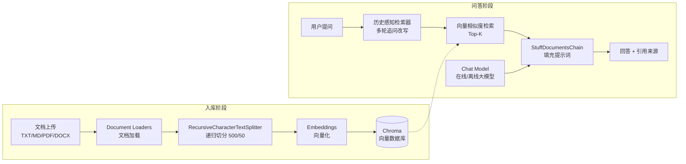

# 📚 SmartKB · 智能知识库问答助手

> 基于 **LangChain** 框架开发的 RAG（检索增强生成）智能应用：上传你的文档，即可用自然语言向知识库提问，回答有据可查、支持引用溯源。

**🌐 开源仓库链接**：<https://github.com/your-username/langchain-kb-qa>
*（提交作业前请替换为你推送后的实际仓库地址）*

---

## 一、项目简介

大语言模型存在"知识过时"和"幻觉"两大问题——它不了解你的私有文档，还常常一本正经地编造答案。SmartKB 基于 **RAG（Retrieval-Augmented Generation，检索增强生成）** 架构解决这个问题：

- **入库阶段**：文档 → 递归切分为文档块（Chunk）→ Embedding 模型向量化 → 存入 Chroma 向量数据库；
- **问答阶段**：用户问题向量化 → 相似度检索 Top-K 相关块 → 填入提示词模板 → 大模型仅依据检索材料作答。

整个项目基于 LangChain 生态构建（Document Loaders、Text Splitters、Chroma VectorStore、LCEL 链式编排），支持 **在线大模型**（智谱 / DeepSeek / 通义 / Kimi / OpenAI 等）与 **完全离线方案**（Ollama 本地大模型 + 本地 BGE 向量化模型），并提供 Streamlit Web 界面与命令行两种使用方式。

## 二、功能特性

| 功能 | 说明 |
| --- | --- |
| 📄 多格式文档入库 | 支持 TXT / Markdown / PDF / Word(.docx)，自动识别 GBK / UTF-8 编码 |
| 🔍 RAG 检索问答 | 向量相似度检索 Top-K 文档块，回答仅基于知识库，抑制幻觉 |
| 💬 多轮对话记忆 | 历史感知检索（History-Aware Retriever），支持"它是什么？""刚才第二点再详细说说"这类追问 |
| 📎 引用来源溯源 | 每条回答可展开查看引用的文档块及来源文件、页码 |
| 🌐 在线 / 离线双模式 | 一个 `.env` 配置切换：智谱 glm-4-flash（免费）/ DeepSeek / 通义 / Kimi / OpenAI；或 Ollama 本地模型 |
| 🧪 离线冒烟测试 | 内置假模型（Fake LLM / Fake Embeddings）测试脚本，无需 API Key 即可验证全链路 |
| 🖥️ 双端入口 | Streamlit Web 聊天界面 + 纯终端 CLI（`cli.py`），适应不同演示环境 |
| 💾 知识库持久化 | Chroma 本地持久化，重启程序知识不丢失；重复上传按内容 MD5 自动去重 |

## 三、技术架构



**技术栈**：Python 3.10+ · LangChain 0.3（LCEL）· ChromaDB · Streamlit · langchain-openai / langchain-ollama / langchain-chroma

## 四、快速开始

### 4.1 环境要求

- Python ≥ 3.10（推荐 3.11）
- 一个大模型 API Key（推荐 [智谱 BigModel](https://open.bigmodel.cn) 的免费 Key，`glm-4-flash` 模型免费且同时提供 Embedding，一个 Key 即可跑通全部功能）；或本地安装 [Ollama](https://ollama.com) 走完全离线方案

### 4.2 安装步骤

```bash
# 1. 克隆仓库
git clone https://github.com/your-username/langchain-kb-qa.git
cd langchain-kb-qa

# 2. 创建虚拟环境（可选但推荐）
python -m venv .venv
# Windows:
.venv\Scripts\activate
# macOS/Linux:
source .venv/bin/activate

# 3. 安装依赖
pip install -r requirements.txt
```

### 4.3 配置模型

```bash
# 复制配置模板
copy .env.example .env        # Windows
# cp .env.example .env        # macOS/Linux
```

编辑 `.env`，填入你的 API Key（以智谱为例）：

```env
LLM_PROVIDER=openai_compatible
LLM_API_BASE=https://open.bigmodel.cn/api/paas/v4
LLM_API_KEY=你的Key
LLM_MODEL=glm-4-flash
```

### 4.4 运行

```bash
# 方式一：Web 界面（推荐）
streamlit run app.py
# 浏览器自动打开 http://localhost:8501，点击左侧「加载示例文档」即可开始提问

# 方式二：命令行
python cli.py --add data/samples/langchain_intro.md   # 文档入库
python cli.py --ask "什么是RAG？"                      # 单次提问
python cli.py                                         # 交互式多轮问答

# 方式三：离线冒烟测试（无需 API Key，验证环境与代码链路）
python tests/test_smoke.py
```

## 五、模型配置速查

| 提供方 | LLM_API_BASE | LLM_MODEL | 备注 |
| --- | --- | --- | --- |
| 智谱 BigModel（默认） | `https://open.bigmodel.cn/api/paas/v4` | `glm-4-flash` | 免费，含 embedding-3，**一个 Key 全功能** |
| DeepSeek | `https://api.deepseek.com/v1` | `deepseek-chat` | 仅对话模型，Embedding 需另配 |
| 阿里通义 | `https://dashscope.aliyuncs.com/compatible-mode/v1` | `qwen-plus` | 百炼兼容模式 |
| 月之暗面 Kimi | `https://api.moonshot.cn/v1` | `moonshot-v1-8k` | |
| OpenAI | `https://api.openai.com/v1` | `gpt-4o-mini` | |
| SiliconFlow | `https://api.siliconflow.cn/v1` | 各类开源模型 | 免费提供 BAAI/bge-m3 向量化 |
| **Ollama（离线）** | `LLM_PROVIDER=ollama` | `qwen2.5:7b` | 本地运行，需先 `ollama pull qwen2.5:7b` |

**完全离线方案**（内网/无网演示）：安装 `pip install -r requirements-offline.txt`，`.env` 中设置 `LLM_PROVIDER=ollama`、`EMBEDDING_PROVIDER=huggingface`（本地 `BAAI/bge-small-zh-v1.5` 向量化），全程不访问外网。

## 六、项目结构

```text
langchain-kb-qa/
├── app.py                     # Streamlit Web 界面入口
├── cli.py                     # 命令行入口（入库/单次提问/交互问答）
├── config.py                  # 全局配置（读取 .env）
├── core/
│   ├── llm.py                 # 模型工厂：Chat Model + Embeddings（在线/离线）
│   ├── loader.py              # 文档加载（txt/md/pdf/docx）与递归切分
│   ├── vectorstore.py         # Chroma 向量库：入库(MD5去重)/统计/清空
│   └── chain.py               # RAG 链：历史感知检索 + 阅读理解生成
├── tests/
│   └── test_smoke.py          # 离线冒烟测试（假模型，无需 API Key）
├── data/samples/
│   └── langchain_intro.md     # 内置示例知识库文档
├── requirements.txt           # 基础依赖
├── requirements-offline.txt   # 完全离线增强依赖（本地 Embedding）
├── .env.example               # 配置模板（多厂商示例）
├── .gitignore                 # 排除 .env / chroma_db 等
└── README.md
```

## 七、核心实现讲解

**1. 文档切分**（`core/loader.py`）——中文友好的递归字符切分，优先按段落、句号断开，块间保留 50 字符重叠避免语义被截断：

```python
splitter = RecursiveCharacterTextSplitter(
    chunk_size=500, chunk_overlap=50,
    separators=["\n\n", "\n", "。", "！", "？", "；", ", ", " ", ""],
)
```

**2. 向量入库与去重**（`core/vectorstore.py`）——以内容 MD5 为文档 ID，重复上传同一文件自动覆盖旧条目：

```python
ids = [hashlib.md5(doc.page_content.encode("utf-8")).hexdigest() for doc in splits]
vs.add_documents(splits, ids=ids)
```

**3. RAG 链编排**（`core/chain.py`）——用 LangChain 官方检索链组件组装"历史感知检索 → 填充文档 → 生成回答"两级流程：

```python
history_aware_retriever = create_history_aware_retriever(llm, retriever, history_aware_prompt)
question_answer_chain = create_stuff_documents_chain(llm, qa_prompt)
rag_chain = create_retrieval_chain(history_aware_retriever, question_answer_chain)
```

**4. 严谨作答约束**——系统提示词明确要求"仅根据上下文回答，资料不足时如实说明，禁止编造"，这是 RAG 抑制幻觉的关键：

```python
QA_SYSTEM_PROMPT = (
    "你是一个严谨的知识库问答助手。请仅根据下面提供的上下文内容回答用户问题……"
    "如果上下文中没有足够信息，请如实回答'根据知识库中的资料，我无法回答这个问题'，禁止编造答案。"
)
```

**5. 多厂商模型适配**——对话与向量化模型均通过 OpenAI 兼容协议接入，换厂商只需改 `.env`，不改代码；第三方接口设置 `check_embedding_ctx_length=False` 以原生文本直传。

## 八、常见问题（FAQ）

**Q1：启动报错"尚未配置大模型 API Key"？**
还没有创建 `.env`。执行 `copy .env.example .env` 并填入 Key；或改用离线方案（`LLM_PROVIDER=ollama`）。

**Q2：智谱 / DeepSeek 的 Key 从哪里申请？**
智谱：<https://open.bigmodel.cn>（glm-4-flash 免费）；DeepSeek：<https://platform.deepseek.com>。

**Q3：Embedding 报 401 / 404？**
部分厂商（如 DeepSeek）不提供向量化接口。默认配置请使用智谱（一个 Key 同时提供两种模型）；或在 `.env` 中为 `EMBEDDING_*` 单独填写 SiliconFlow 等平台的地址与 Key。

**Q4：如何彻底离线运行？**
安装 Ollama 并 `ollama pull qwen2.5:7b`，再 `pip install -r requirements-offline.txt`，`.env` 设置 `LLM_PROVIDER=ollama` 与 `EMBEDDING_PROVIDER=huggingface`。

**Q5：回答不理想怎么办？**
调参重试：`.env` 中增大 `TOP_K`（检索更多块）、调整 `CHUNK_SIZE`（长文档适当加大）、调低 `TEMPERATURE`（回答更严谨）。

**Q6：知识库数据存在哪里？如何删除？**
本地 `./chroma_db` 目录，不上传任何服务器；Web 界面点击「清空知识库」或执行 `python cli.py --reset` 即可删除。

## 九、安全提示

- `.env` 含 API Key，已在 `.gitignore` 中排除，**切勿提交到公开仓库**；
- 首次部署建议将 `TEMPERATURE` 保持为 0.2 以下，知识库问答场景要求回答稳定、有据可查。

## 十、License

[MIT](LICENSE)
